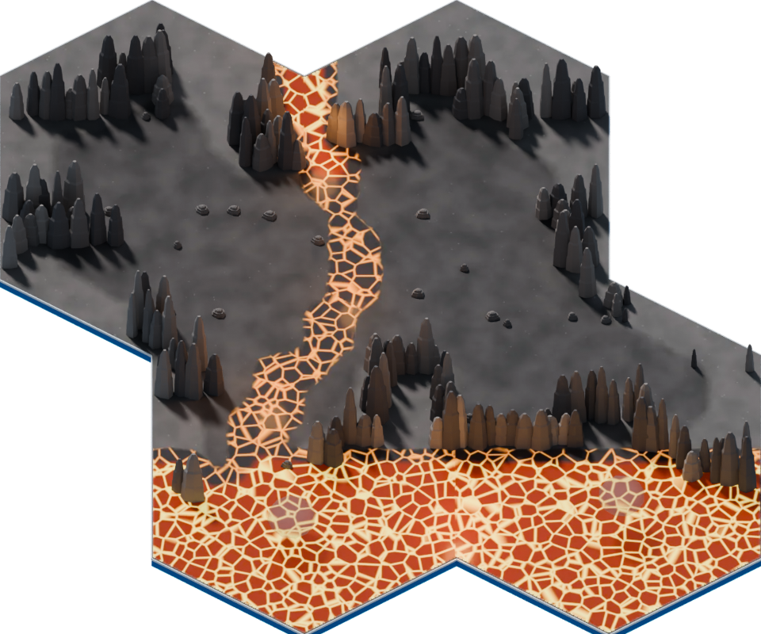
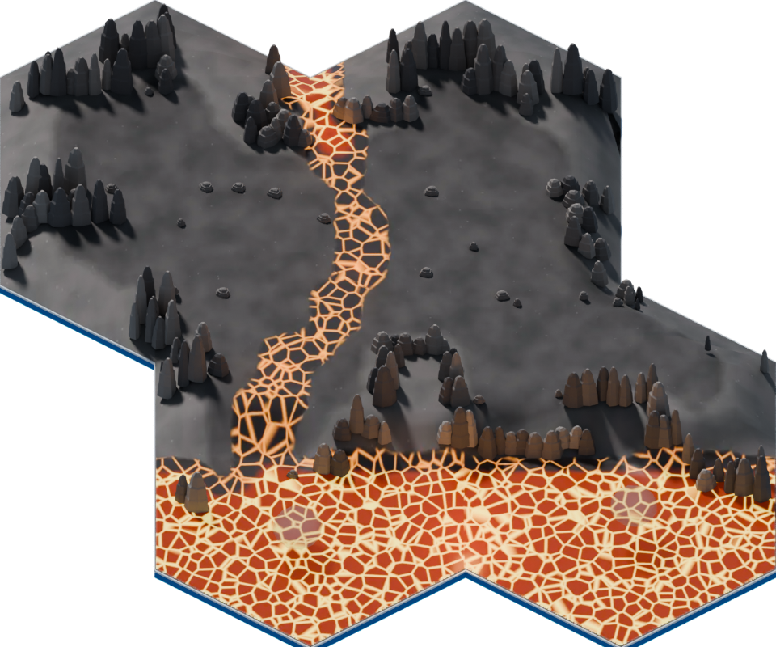

# CM07 幾何精修候選 r2（2026-10-23）

狀態：ART_REVIEW_CANDIDATE，未晉級公開遊戲資產；本頁補充本目錄較早的工程階段報告。獨立 Draft PR #74：https://github.com/Orochi771127/championship-2026/pull/74 。不合併、不部署。

以上為 Blender 5.2.0 LTS / Cycles 32 samples 的實際 960×800 渲染，不是遊戲截圖。使用同一私有副本、鏡頭、光源與 frame 1。r1 因前緣熔岩被材質分區切斷、坡面法線出現三角塊而未採用；r2 消除退化面並平滑地表法線，河道使用連續原有貼圖。

## 本次實際變更

- 在內側加入最高 0.85 世界單位的平台高差；前緣約 8 native pixels 的坡落讓河道沿幾何向下流接前池。
- 外圈 14 native pixels 內逐漸回到既有接縫零高度；接縫、接合條與基座原幾何不變。沒有移動平面上的岩柱 footprint。
- 中央尖柱高度縮至原來 48%，前緣範圍縮至 65%，其餘 80%；小石保留大小並隨地表抬升。保留遮擋所需岩柱幾何。
- 四張既有 1024×1024 WebP、熔岩 mask、固定視角與六角外輪廓不變。未從原作研究圖擷取、描摹或新增公開像素。

來源是 20261021 位置修正版與 current GLB 貼圖重建，不是找回最終 PBR 母檔。私有母檔原 SHA-256 `6c6343b699c20e91edac2c2a7adabb168322350fff6d52c0834f3ac06db76cfa`、工作副本來源 `b8ab586f12f1f44625668674e1542009d8404077b0cd869c25318c8d12c1230e` 保持不變。Blender 始終 disable-autoexec、use_scripts=False；未使用未知內嵌腳本。

## 大小與成本（靜態值，非裝置實測）

| 項目 | 現行 GLB | r2 review GLB |
|---|---:|---:|
| bytes | 337740 | 1423220 |
| primitives | 32 | 32 |
| triangles | 18036 | 20054 |
| 貼圖 | 4×1024² | 相同四張、相同 bytes |
| RGBA8 含完整 mip 估算 | 22369616 bytes | 22369616 bytes |
| saver 512² 含 mip 估算 | 5592400 bytes | 5592400 bytes |

r2 SHA-256：`1e6d0fb8c706ea2bdf0998f6cc3c8c1d8bf7dea672e23701fde175e3baf6dc38`。

既有 Draco 壓縮未改動節點維持原資料；五個改動節點以標準 glTF accessor 打包，未呼叫舊環境有 cache 寫入拒絕的 exporter。新網格未壓縮，因此 bytes 明顯增加；不能稱為效能改善或已完成手機最佳化。母檔高解析資料未進公開 payload。review GLB 和對應 walk-surfaces 僅存於 tests/fixtures/cm07-review；正式 manifest、公開 allowlist 選取仍為現行 GLB。

## 工程與驗證邊界

既有 ranch 單一 render clock 接入 CM07 專用 ambient controller，沿用 dispose。熔岩只在原 mask 內 ±6% 明滅、不滑動 UV；煙霧不寫深度、不投射實心陰影，保留深度測試。reduced motion、covered、離屏控制已有 focused CPU tests；不能代替瀏覽器。

PR 初始 head `01594e290a71751acaa06ca30a2e5b4205652be5` 的 GitHub CI run `39938696553` 已完成 locked npm ci、deterministic tests、build:playtest、validate:playtest，全部成功。後續 head 應重新核實，不能沿用這個成功代替新 head。

新增 CM07 candidate renderer review workflow 沿用既有 Ubuntu 22.04 / Node 22 / lockfile / Playwright。它在測試 route 中替換 CM07 hash、GLB 和對應地表資料，實際使用 production createRanchThreeScene；檢查單張/合法相鄰、八向 pan、兩時間點、reduced motion、covered、離屏、dispose/reenter、390×844 saver 模擬，保存 PNG、draw calls、triangles、texture count、renderer 資訊。它使用人工呼叫 render 的隔離 fixture，沒有真角色、正常 UI 流程或實機手機；不能當作完整遊戲驗收。

仍須正常遊戲中的角色前後遮擋、煙霧前景、角色與陰影同地表、相鄰邊界與 wrap 實際觀感、進出 cleanup，以及實機手機效能。粗熔岩網紋、前池形狀與原作構成仍有差距；這是一次必要構成的最小實際精修，不是整圖完成或其餘 36 張批准。

## 本機阻礙與交付

原 Git fetch/push 失敗訊息為 getaddrinfo() thread failed to start；未證實 DNS 問題，未盲重試、未改 DNS/ACL/代理。官方已連接 GitHub connector 先查明分支/commit 不存在，再交付完全相同 tree，成功建立 PR。沒有需要等待的 fetch 核准。

本機 node_modules junction 建立曾存取被拒，沒有建立成功；不重試、不以其他 link 替代。依賴安裝與瀏覽器工作只在既有 CI runner 依鎖檔進行。舊 Chromium 問題未重試；未修改任何安全限制、網路或 credentials。

私有交付：`R:/Projects/Championship2026/cm07-art-sample-20261023/geometry-r2/CM07_geometry_r2.blend`，同目錄含 before/after、GLB、geometry-receipt、walk surfaces；原母檔未覆寫。此 PR 與 feat/dex-detail-swipe 不共用修改檔案。

靜態補驗：修正三個角點的零法線輸出後，GLB indices/normals、所有 node transforms/materials/images 不變性、原母檔雜湊、27 個未改節點均通過。2070 個地表三角形與 GLB 對應誤差最大 2.842170943040401e-14，外圈高度差 0；見 tests/fixtures/cm07-review/validation.json。
