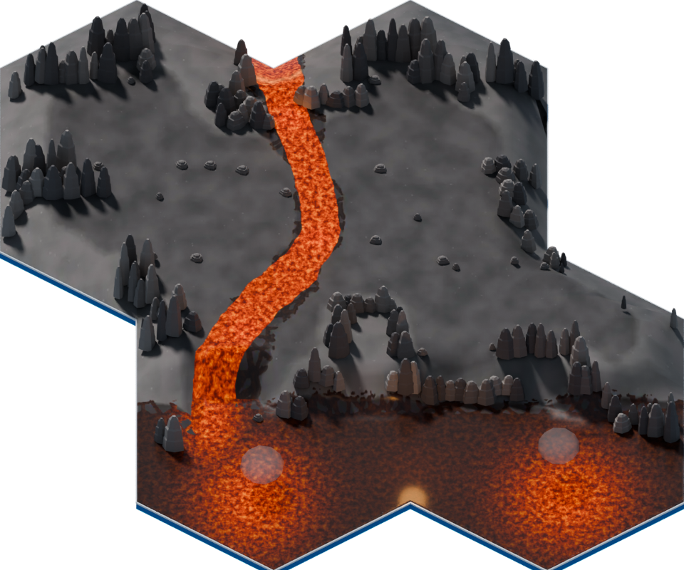

# CM07 r3：熔岩細紋與前池候選

狀態：ART_REVIEW_CANDIDATE。PR74 保持草稿；本輪不合併、不部署。以下是實際 Blender 固定鏡頭渲染，不是遊戲截圖。

本輪只修改 basecolor 與 emissive：將既有粗白網格改成細碎熱紋，接續前緣落差的熱區，前池改成兩處熱區與暗冷卻殼。由 Blender 節點烘焙成固定貼圖，沒有新增 runtime shader 或貼圖滑動。材質仍由既有 CM07 controller 做有界明滅。沒有取用原作圖像像素；原作對照只留在私有 R 審閱文件，不進 repository。

r2 幾何、固定鏡頭、外圍拼接、walk surfaces、玩法地塊維持不變。新視覺河道沿既有 production 河道重新連成連續區域，不宣稱原 emissive mask 位元不變。normal / roughness-metallic 圖的原始 bytes 保留。母檔及 r2 完整保留。

尚需目視決策：r3 河道較連續、紋理更細，但前池仍較原作寬；原有煙霧球在暗池上輪廓更顯眼。這是可審閱的小範圍精修候選，不代表完全重現原作或整張完成。

## 體積診斷與量測

| 版本 | bytes | 說明 |
|---|---:|---|
| 現行 production | 337,740 | 18,036 triangles |
| 原 r2 | 1,423,220 | 五個修改網格未壓縮，含未引用舊資料 |
| r2 位元無損 Draco | 1,168,272 | 每個 triangle corner 屬性位元相同 |
| r2 高精度 Draco | 557,908 | 同貼圖，量化誤差經 decode 實測 |
| r3 高精度 Draco + 新無損 WebP | 1,100,296 | 32 primitives / 20,054 triangles |

r2 增大主因是未壓縮網格，不是新增材質數量。清除未引用 accessor / bufferView 並用已安裝官方 Blender Draco bridge 壓縮五個修改網格，保留其餘 27 個壓縮 primitive。沒有安裝軟體，也沒有重試 exporter cache 寫入。

新兩張貼圖為 1024²：basecolor 490,198 bytes，emissive 201,424 bytes。WebP 使用 lossless，解碼 RGBA 與 Blender 烘焙 PNG 逐位元相同。這兩張新圖比舊圖大，因此 r3 並非 557,908 bytes。r3 比原 r2 少 322,924 bytes（22.69%），仍比 production 大 762,556 bytes；不宣稱相對 production 效能提升。

高精度 Draco 使用 position22 / normal18 / UV20 bits，並非數學無損。逐 triangle corner 解碼比較：最大位置誤差 0.000003814697265625 world units、normal component 0.000013053417205810547、UV 0.000000476837158203125（1024 圖約 0.000488 texel）。triangle 數與順序保留。

GLB SHA256：`98401d4551f63cdcb7180070e06ca54fd6999ee4b5c7307e0d9003eec1723da5`。

四張 1024² 的 RGBA8 + 完整 mip 理論用量仍為 22,369,616 bytes；512 saver 為 5,592,400 bytes。這是圖像記憶體估計，不是裝置 GPU 量測，未含 shadow / render targets。

## 已驗證與未驗證

已實際開啟原作、現行重建、r2、r3，並檢視解碼重建的 r3 固定鏡頭 render。解碼前後 960×800 render 的平均 RGB 絕對差為 0.0227 / 0.0220 / 0.0230（0–255）；最大單點差 48，含法線重建及 ray / denoise 敏感度，不能宣稱圖像位元相同。未見整體構圖或河道漂移。

GLB 位於 `tests/fixtures/cm07-review/field_cm07_01.material-r3.glb`，只供既有 renderer fixture；production manifest、公開資產選擇與其他 36 張均未變更。舊 r2 fixture 保留。測試只將 candidate route 改到 r3，沒有新增依賴或測試框架。

r2 的既有 CI renderer PASS 不等於 r3 PASS。r3 需在其精確 head 重跑；結果另附 PR。孤立 renderer fixture 沒有真角色、正常遊戲 UI / ticker 或實體手機，因此角色前後遮擋、接觸陰影、正常進出與手機效能仍未驗。不得由 CPU test、Blender render 或桌機窄視窗代替。

本機 IAB 與已連接 Chrome 連 `127.0.0.1:8768` 對照頁皆回報 `ERR_CONNECTION_TIMED_OUT`，停止該檢視路徑，沒有修改 DNS / ACL / firewall。私有離線 HTML 與單張 SVG 對照已生成；沒有把逾時視為畫面驗證成功。既有 node_modules junction 拒絕、Git transport 失敗與 artifact 下載問題均未重試。
