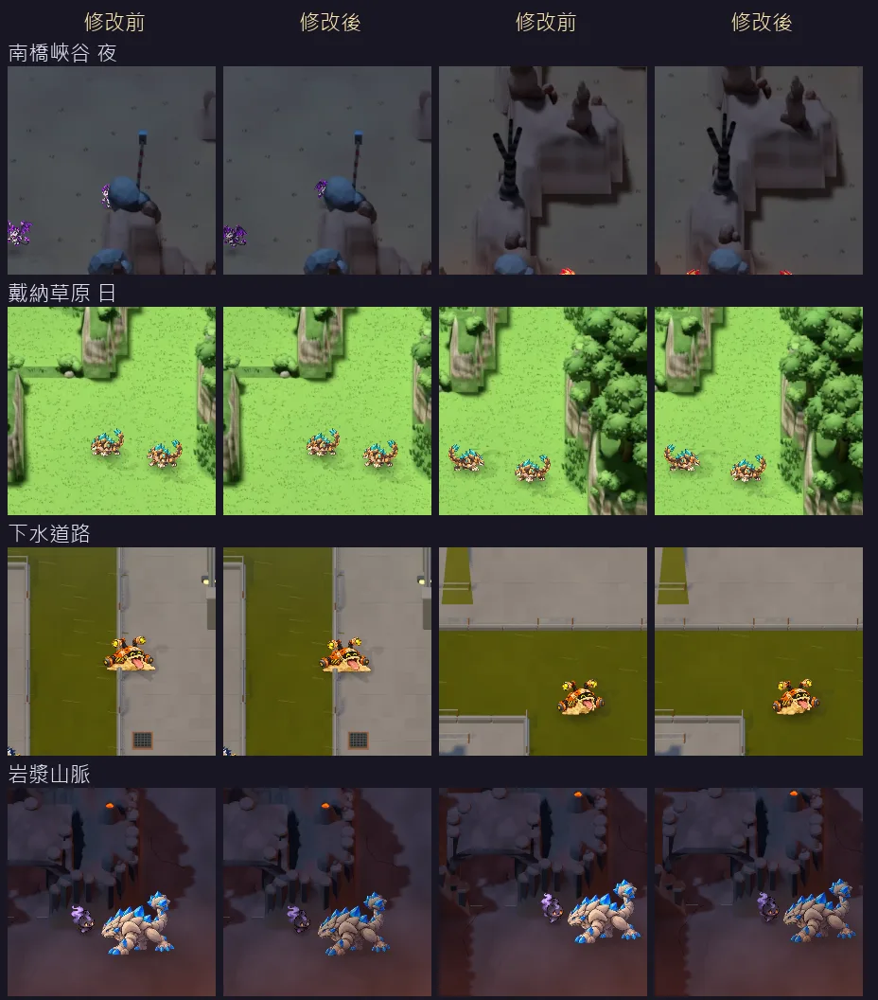

# 狩獵角色吃地圖的光（2026-11-25）

Owner：「那些角色，要如何才可以像是生活在地圖裡嗎？而不是一個貼紙浮在地圖上面的感覺。」

## 原因

- 角色本來就在 3D 場景裡，會被樹遮擋，也有接觸陰影和投影。
- 但角色材質（`MeshBasicMaterial`）不受場景燈光影響：晚上、下水道裡的地圖變暗變藍，角色卻維持白天的亮度，看起來像貼上去的。

## 這一批（A：光）

`src/championship/presentation/vs2/huntThree/actorLight.mjs`，數值全部取自各地圖既有的 HD-2D 光（`hd2dLook.mjs`），沒有新美術。

1. **亮度與色溫：** 依地圖的主光、補光、天空光計算，以預設白天為基準。白天約 1.0，晚上約 0.55 並偏冷。
2. **地面反光：** 畫面最下方約三分之一帶一點地面色；岩漿山脈改成橘色，從腳下透光。
3. **邊光：** 朝太陽那一側、輪廓線內側的一格像素，加上主光的顏色。

只改畫面，不動原本的位置、畫格、透明度和色調。

## 驗收

- 實機：Chromium＋ANGLE D3D11，1366×768。
- 地圖：南橋峽谷（夜）、戴納草原（日）、下水道路、岩漿山脈，四張都是 3D active。
- 結果：0 個頁面錯誤。console 只有 Three 原本就有的棄用警告，修改前後完全一樣。
- 白天幾乎不變；夜間和岩漿地圖的角色降到跟場景一致的亮度和色溫。
- 單元測試：`tests/championship-hunt-actor-light-cases.mjs`（4 項），狩獵相關測試 270 項通過、0 失敗。

## 下一步（B、C）

- **B 地面接觸：** 依地形做草叢遮腳、入水線、漣漪、腳印、熱氣扭曲。
- **C 生活感：** 草叢反應、分層粒子、隨風擺動。
