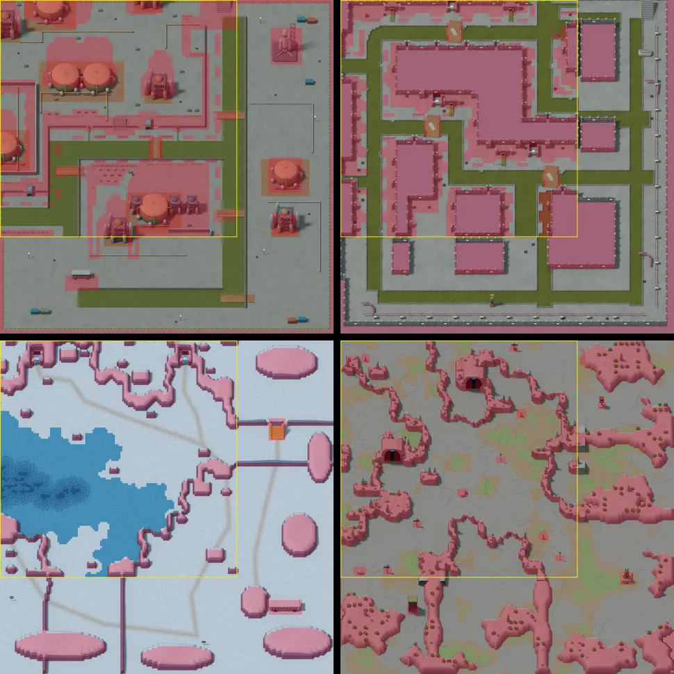

# 狩獵地圖擴大：杜比工廠、下水道路、雪之國度、裂岩地帶（2026-11-25）

Owner：「我每一張地圖其實都要擴大」。

這四張地圖和其他 11 張一樣，從 128×128 格（2048）擴大到 180×180 格（2880）。之後只剩 hm08 南橋峽谷還是 2048。

## 資料（可走範圍）

由 `scripts/build-hunt-expansion-four-20261125.mjs` 從交件候選資料產生，寫入 `hunt-art-expansions-20261023.json`。加上 `--check` 會核對檔案與重新產生的結果是否一字不差。

- **原始格子不動：** 128 格的原始區域留在左上角，地形一格都沒改。新增的格子只往東、往南延伸。
- **舊邊界的逃脫格：** 原本 x=127、y=127 這兩條邊上的「逃出地圖」格，如果外面還有路，就改成一般的移動格。hm09、hm02 當初也是這樣改的。
- **夜間版：** hm13、hm14 沒有交件夜間版，按照已上線地圖的規則產生：
  - 原始區用原作的夜間資料；
  - 被改過的邊界格沿用白天的改法；
  - 新增區用白天的資料。
  - 這條規則在 hm02、03、15、16 已上線的 16,384 格上全部成立。
- **洞穴：** hm14 沒有洞穴資料，從洞穴錨點補上 2 個。
  - 計算規則和 hm09 交件的 3 個洞穴逐格相同；腳本每次執行都會自我檢查這一點。
- **順便修正（已上線的 bug）：** hm15～hm18 日夜共 8 個場地，舊 2048 邊界上還留著 109～225 格逃脫格。
  - 影響：逃跑中的野生角色走到地圖中間那條舊邊線，會被當成「跑出地圖」瞬移。
  - 處理：改成一般移動格。除了這些格子，其餘資料完全沒變（已逐格比對）。

可走範圍和美術逐格對照（紅色＝不能走，黃框＝原本的 2048 範圍）：

## 3D 與備用圖

- **3D 模型：** 改用沒裁過的 2880 候選模型（`hmXX-three-c2-20261125`）。
  - hm10、hm11、hm13 與交件檔逐位元組相同。
  - hm14 沿用 10-26 的處理（乾地顏色往中間色拉近 45%、Draco 重新壓縮），但這次不裁切：15.1 MB 壓到 8.35 MB。
  - hm14 的地面高度重算整張 180×180。沒取到高度的 40 格全部在原始區，跟 10-26 的版本一樣。
- **備用 2D 圖（3D 載入失敗時用）：** 2880 版共 6 張（hm10／hm11 只有白天，hm13／hm14 有日夜），用 Blender Cycles 以遊戲相同的鏡頭算圖。
- **公開清單：**
  - 用 `select-hunt-three-public-20261023.mjs` 和 `reconcile-public-runtime-selection.mjs` 更新，舊的 c1 資料夾已移除。
  - 網站大小只多 1.3 MB（加 26.5 MB、減 25.2 MB）。
  - 本機 `build:playtest` 通過。

## 驗收

- **單元測試：**
  - `championship-hunt-three-c1-maps-cases.mjs`：改成檢查 2880，另外新增兩項：原始格子不動、舊邊線不能有逃脫格。
  - 狩獵相關測試全部通過。
- **實機：** Chromium＋ANGLE D3D11，1366×768。四張地圖都是 3D active、世界 2880，可以拖到新區最右下角；野生角色會走進新區；0 錯誤、0 缺檔。

## 還沒修的美術問題（下一批）

- **hm14：** 原始區是方塊狀的懸崖，新增區是圓管狀的山脊，交界處風格不一致。
- **hm10、hm13：** 新增區比原始區空很多（大片空地、橢圓平台），要補物件。
- **hm13：** 冰崖沿著格子線呈階梯狀。
- **hm10／hm11：** 水面接縫，排水動畫還沒接上。
