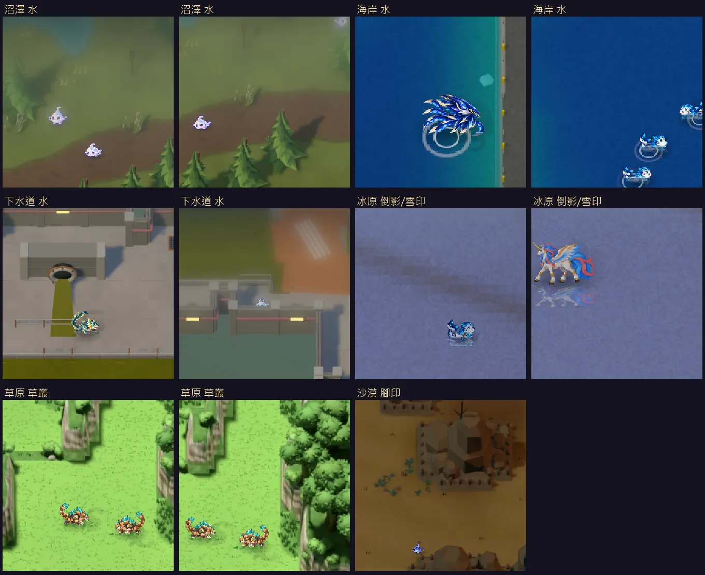
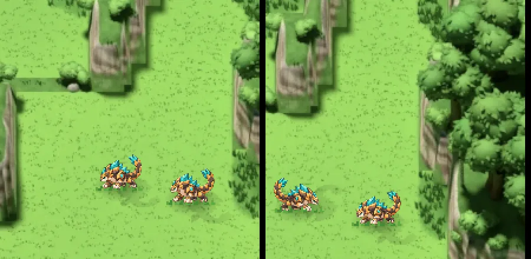

# 狩獵角色與地面互動（2026-11-25，B 批）

Owner：「那些角色，要如何才可以像是生活在地圖裡嗎？而不是一個貼紙浮在地圖上面的感覺。」

接在 A 批（角色跟著地圖光線，#309）之後。效果依原作地形格（2 淺水、3 冰）和地圖類型決定，只改畫面，不改位置、畫格和原作模擬。

| 地面 | 效果 | 地圖 |
|---|---|---|
| 淺水 | 下半身沉到水線以下（帶水色、半透明，水線有一道泡沫），腳邊擴散兩圈漣漪；跳起時水線消失 | 沼澤、海岸、下水道、草原湖邊 |
| 冰 | 冰面上有目前畫格的淡淡倒影 | 雪之國度 |
| 草 | 腳前長幾根像素草，依身體下緣置中 | 草原、莽原、森林、叢林 |
| 沙／雪 | 每走 9 px 留一個腳印，4.2 秒淡出，最多 18 個 | 灼熱沙漠、澄澈綠洲、雪之國度 |

- **只在草地長草：** `grassTiles.mjs` 標出哪些格子是草地，由 `scripts/build-hunt-grass-tiles-20261125.py` 從四張日間圖產生。土路、水、平台、物件上都不長草。
- **只讀介面：** runtime 新增 `getTerrainAt`，畫面層透過 `terrainAt` 讀取地形。
- **水線：** 加在角色 shader 裡（`actorLight.mjs` v2），每隻角色有自己的水線高度。

## 驗收

- **實機：** Chromium＋ANGLE D3D11，1366×768。在沼澤、海岸、下水道、雪之國度、戴納草原、灼熱沙漠，各拖到有野生角色的地方截圖。

| 地圖 | 測到的效果 |
|---|---|
| 沼澤 | 漣漪 4 |
| 海岸 | 漣漪 14 |
| 下水道 | 漣漪 2 |
| 雪之國度 | 倒影 7、腳印 78 |
| 戴納草原 | 草叢 3 |
| 灼熱沙漠 | 腳印 45 |

- 全部 3D active，0 個頁面錯誤。console 只有 Three 原本的棄用警告。
- **自動測試：** `tests/championship-hunt-ground-contact-cases.mjs`（6 項）；test:ci 4096/4096；本機 `build:playtest` 通過。

## 下一步（C 批）

- 走過草叢時草會晃。
- 分層粒子（螢火蟲、落雪、塵埃）在角色前後飄。
- 角色隨風輕擺。
