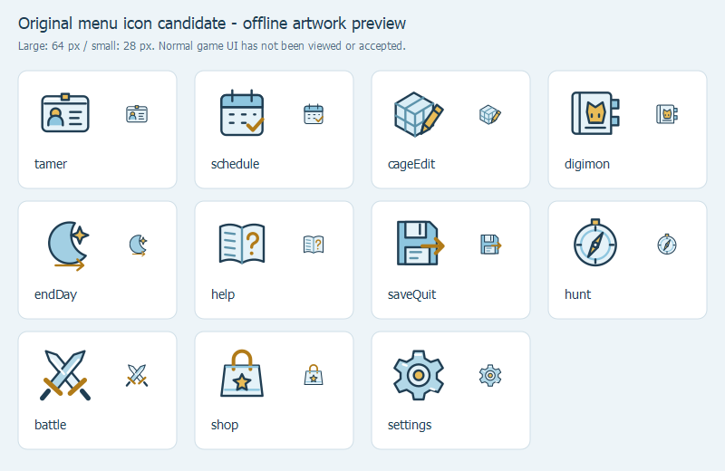

# 選單圖標與共用提示音：離線候選交付

2026-10-24；狀態：`OFFLINE_CANDIDATE_IMPLEMENTED_BROWSER_AND_LISTENING_PENDING`。

本報告接續[原先拒絕紀錄](REPORT_ZH_TW.md)。後續委派明確解除「先正常 UI 查看才可修改」的流程依賴，授權依程式與本機資產完成隔離候選及非瀏覽器檢查；沒有解除工具權限。沒有再次導向任何網址、更換瀏覽器／代理／環境、建立 junction、改權限、裝套件或付費。先前的拒絕紀錄保持原樣。

工作樹：`R:/Projects/Championship2026/ui-completion-candidate-20261024`；分支：`feat/ui-completion-candidate-20261024`；產品差異基準：`105fafbd4d6a736476a414825e0dcfcf8ef8611c`。僅本地提交，不 push／merge／deploy。

## 圖標實作與映射

新增 11 張原創、透明背景、48×48 viewBox SVG。深藍描邊搭配淺藍及金色細節，不含外部圖片、字型、腳本或來源遊戲描圖。先讀取本機既有 Database 書本與 System 工具圖作風格參考，沒有修改它們。

[`toolbarMenuIcons.js`](../../../src/championship/presentation/toolbarMenuIcons.js) 先保留既有 `originalDatabaseIcon(entry.screen)` 結果，再以 `entry.id` 補入候選；action 入口沒有 screen 也能取得圖標。[mapping／來源 manifest](../../../src/data/championship/toolbar-menu-icons.r1.json) 記錄每張檔案的 bytes 與 SHA-256；[原創路徑生成器](../../../scripts/build-menu-entry-icons.mjs) 可重建，`--check` 驗證相同 bytes。

| entry.id | 圖標意象 | 結果 |
|---|---|---|
| tamer | 身分證 | 新 SVG |
| schedule | 日曆與勾選 | 新 SVG |
| cageEdit | 方格與筆 | 新 SVG |
| digimon | 夥伴名冊 | 新 SVG |
| endDay | 月亮與離日箭頭 | 新 SVG，涵蓋 action |
| help | 說明書與問號 | 新 SVG |
| saveQuit | 磁碟與離開箭頭 | 新 SVG，涵蓋 action |
| hunt | 探索羅盤 | 新 SVG |
| battle | 交叉對戰符號 | 新 SVG |
| shop | 商店袋 | 新 SVG |
| settings | 齒輪 | 新 SVG，涵蓋 action |
| database／medals | 既有已定稿圖片 | 保留原檔、原 mapping |

沿用 `.cm-toolbar__entry-icon` 樣式，沒有新增或修改 CSS、文字、分組、標籤、按鈕節點或目的地。圖標是空 alt 的裝飾，原按鈕仍承接點擊及可存取名稱。既有 `:has(icon)` 會為新增圖標預留文字右側空間，實際換行、按鈕尺寸與各語言畫面尚須正常瀏覽器確認；DOM mock 不證明 44px 觸控尺寸。



[向量接觸圖](contact-sheet.svg)由本機 SVG 合成，再用已安裝 ImageMagick 離線轉 PNG，已查看 64px／28px 圖標預覽並修正預設填色；沒有瀏覽器截圖。此項只代表離線圖稿檢視，沒有宣告遊戲 UI、手機、桌面或實體裝置驗收。

## 四種提示音與事件範圍

[`uiCuePlayer.js`](../../../src/championship/presentation/uiCuePlayer.js) 由 main 注入既有 `settings.audio`，只使用 `settings.audio.output('sfx')` 的同一 AudioContext／category graph，不建立第二 bus、context、ticker 或 timer。Mute、master 與 sfx 音量沿用既有 bus；music 音量不影響 UI。新的單振盪器聲音沒有取代任何既有音效。

| cue | 單振盪器設定 | envelope 時間（另加 5ms 停止尾端） | 產品接點 |
|---|---|---|---|
| select | sine，739.99→987.77Hz | 45ms | 工具選取、選單入口、設定分類 click |
| open | triangle，523.25→783.99Hz | 85ms | 管理／系統選單開啟 click |
| back | sine，783.99→523.25Hz | 75ms | 選單按鈕收起、工具取消／完成、設定分類返回／關閉／背景 click |
| reject | triangle，246.94→196Hz | 95ms | **已備妥，但待確證 domain 失敗接點；未接產品流程** |

共用 80ms 節流；同一事件物件只消耗一次；新 cue 清理前一個 voice，結束後斷開 oscillator／gain；pagehide 只清理此 player，不關閉應用程式 audio bus。只允許 `type==='click' && isTrusted===true`：原生鍵盤啟動按鈕所產生的 trusted click 可適用，但實際瀏覽器行為尚未驗證。無事件、合成 `.click()`、pointerdown、keydown、hover、focus 均不發聲。context 未 running 時直接略過，不排隊重播。

`closeMenu`／`selectTool` 本身沒有音效；導頁清理、模式切換、自動教學、Escape 與背景 pointerdown 關閉保持靜默。disabled 控制項不請求 reject，亦不讓合成 disabled 事件收起選單。沒有任意把一般 UI 拒絕、存檔錯誤或 gameplay false 接成 reject。這次 back 的覆蓋限上述選單／設定接點，沒有為所有遊戲返回按鈕鋪設全域 listener。

## 檢查結果：全部是非瀏覽器證據

針對性執行 7 個 test 檔案，共 **66／66 通過**：

```powershell
node --test tests/championship-ui-cue-cases.mjs tests/championship-toolbar-menu-icons-cases.mjs tests/championship-ui-completion-dom-cases.mjs tests/championship-toolbar-layout-cases.mjs tests/championship-toolbar-point64-intake-cases.mjs tests/championship-settings-cases.mjs tests/championship-battle-optional-audio-cases.mjs
node scripts/build-menu-entry-icons.mjs --check
```

- 新增測試共 14 項：13 入口 mapping 與三個 action、原圖保留與 SVG hash；4 cue 的同一 context／sfx graph、音量、去重／節流、無效事件、mute／零音量、不重播、清理；DOM mock 中的入口文字／角色／圖標／handler、選單與工具 click、disabled／自動教學靜默、Escape 返回 opener 焦點、設定返回／關閉。
- 既有 52 項 focused 回歸：toolbar 高度／Hunt／教學、原八格工具圖路徑與 hash、設定與 shared audio bus、54 個 Battle 聲音與載入釋放行為。
- 6 個變動／新增 JS 模組與生成器均通過 `node --check`；scoped `git diff --check` 通過。圖標重建／hash 檢查通過。
- DOM 使用明示的 controlled fixture，AudioContext 使用 fake graph 與事件紀錄；不是正常瀏覽器、不是真正聲音輸出，亦沒有冒稱聽覺驗收。固定 mock geometry 只讓原測量程式可執行，未用來宣告尺寸 PASS。
- 檢查過程先修正測試 fixture 的匯入名稱及 Storage-like removeItem，再修正 SVG 預設填色；最後結果如上，完整最終 test log 已歸檔。

## 保留項目與剩餘 blocker

`audioBus.js`、Battle／Arena／ceremony 聲庫、BGM、`public-ui-selection.v1.json`、`public-playtest.r1.json` bytes 與基準相同；既有八格工具圖亦有 focused hash 回歸。沒有改品牌、研究／rights／provenance、render projection、hash gate、籠子相鄰擺放、GR01–GR09、戰鬥／存檔／狩獵規則或首頁候選 `07cad19b`。本批未刷新 publication allowlist 或執行公用發佈建置。

1. **正常瀏覽器仍被拒**：先前目標 `http://127.0.0.1:8746/full-qa-save.html`，錯誤 `net::ERR_NETWORK_ACCESS_DENIED`，結果確定為導向失敗，沒有 installer click 或遊戲畫面；不代表桌面離線。這次沒有重試該操作或換方式。手機／桌面正常流程、重複點擊、靜音、返回、鍵盤焦點及版面仍待允許環境驗證。
2. **實際聽覺待驗收**：沒有可用的聽覺試聽工具；只完成 fake AudioContext graph／事件檢查，聲音音色、音量舒適度、裝置輸出未驗收。
3. **reject 待接**：本批沒有確證適合的 domain 失敗回傳接點，依後續指示只備妥 cue，不亂接。需另就具體操作確認失敗語意與重複通知後再接。
4. 先前 `node_modules` junction 建立收到「存取被拒」，未建立、未重試、未改權限；依賴的一般複製是上一階段已完成，本次只使用既有可用工具。沒有新增權限要求。

R 槽追加歸檔：`R:/Projects/Championship2026/ui-completion-archive-20261024/implementation-r1/`，保留前階段所有拒絕紀錄，另含本批報告、完整可讀 patch／diff、mapping／cue 清單、圖稿接觸圖、測試 log、保留檔案雜湊與 Git bundle。工作樹的 `output/` 保留未追蹤工作腳本，沒有收進產品 commit。
